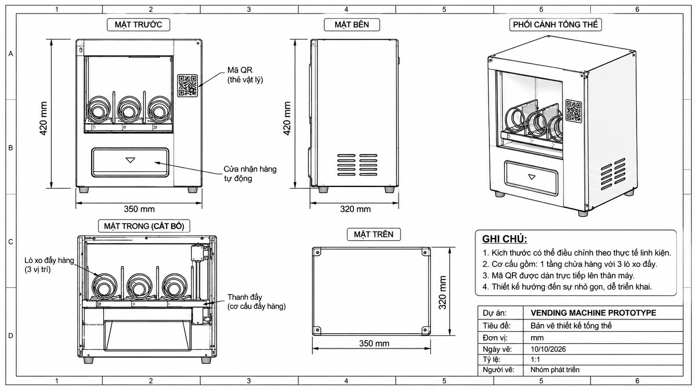
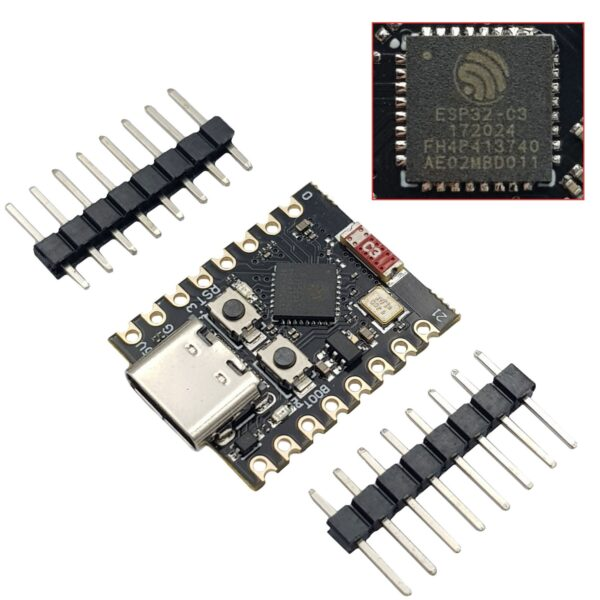

<div align="center">

# 🛒 FreshVend — Smart IoT Vending Machine Prototype
### Hệ Thống Máy Bán Hàng Tự Động Thông Minh Tích Hợp Thanh Toán VietQR & Điều Khiển Phần Cứng ESP32 Qua MQTT over TLS

[](https://openjdk.org/)
[](https://spring.io/projects/spring-boot)
[](https://react.dev/)
[](https://www.typescriptlang.org/)
[](https://tailwindcss.com/)
[](https://www.postgresql.org/)
[](https://www.emqx.com/)
[](https://www.espressif.com/)
[-success?style=for-the-badge&logo=checkmarx&logoColor=white)](#-kết-quả-kiểm-thử-toàn-diện)

<p align="center">
  <b>Hệ thống máy bán hàng tự động không dùng tiền mặt, không cần cài đặt ứng dụng: Khách hàng quét mã QR trên thân máy ➔ Chọn món ➔ Thanh toán qua VietQR tự động ➔ Backend xác minh Webhook ngân hàng ➔ Phát lệnh MQTTS an toàn ➔ Vi điều khiển ESP32 nhả hàng chuẩn xác.</b>
</p>

</div>

---

## 📌 Mục Lục

- [1. Giới Thiệu Dự Án](#1-giới-thiệu-dự-án)
- [2. Thiết Kế Cơ Khí & Kiến Trúc Phần Cứng](#2-thiết-kế-cơ-khí--kiến-trúc-phần-cứng)
- [3. Kiến Trúc Hệ Thống (System Architecture)](#3-kiến-trúc-hệ-thống-system-architecture)
- [4. Các Tính Năng Nổi Bật](#4-các-tính-năng-nổi-bật)
- [5. Cấu Trúc Mã Nguồn](#5-cấu-trúc-mã-nguồn)
- [6. Công Nghệ Sử Dụng](#6-công-nghệ-sử-dụng)
- [7. Hiện Trạng Triển Khai Cloud](#7-hiện-trạng-triển-khai-cloud)
- [8. Kết Quả Kiểm Thử Toàn Diện](#8-kết-quả-kiểm-thử-toàn-diện)
- [9. Hướng Dẫn Cài Đặt & Phát Triển Cục Bộ](#9-hướng-dẫn-cài-đặt--phát-triển-cục-bộ)
- [10. Tài Liệu Kỹ Thuật Tham Khảo](#10-tài-liệu-kỹ-thuật-tham-khảo)
- [11. Nguyên Tắc Bảo Mật](#11-nguyên-tắc-bảo-mật)

---

## 1. Giới Thiệu Dự Án

**FreshVend (Vending Machine Prototype)** là dự án phát triển giải pháp máy bán hàng tự động hiện đại, giải quyết triệt để các nhược điểm của máy bán hàng truyền thống (kẹt tiền mặt, nuốt tiền thừa, giao diện cồng kềnh, thiếu hệ thống đối soát giao dịch):

1. **Khách hàng không cần tiền mặt:** Chỉ cần một chiếc điện thoại thông minh bất kỳ có camera để quét mã QR dán trên thân máy.
2. **Không cần cài app, không cần đăng ký tài khoản:** Ứng dụng Web App phản hồi tức thì với tốc độ tải trang dưới 1 giây, giao diện thân thiện tối ưu cho màn hình di động.
3. **Thanh toán tự động hóa 100%:** Sinh mã VietQR động chuẩn NAPAS 247 kèm chuỗi đối soát duy nhất. Backend tự động lắng nghe Webhook ngân hàng (SePay) để xác thực dòng tiền thực tế, loại trừ hoàn toàn nguy cơ gian lận hình ảnh hay giả mạo nút bấm thanh toán.
4. **Cơ chế nhả hàng an toàn qua IoT (MQTT over TLS):** Lệnh nhả hàng được mã hóa phát tới vi điều khiển ESP32, hỗ trợ kiểm tra tính toàn vẹn trạng thái trong bộ nhớ Flash (NVS) và kiểm tra hạn lệnh đa tầng, đảm bảo **không bao giờ nhả hàng 2 lần**.
5. **Cổng đối soát & Quản trị chuyên sâu (Admin Reconciliation):** Cung cấp công cụ cho ban quản trị theo dõi chi tiết dòng thời gian đơn hàng, nhật ký sự kiện phần cứng và xử lý hoàn tiền / nhả hàng lại nhanh chóng khi phát sinh sự cố cơ khí.

---

## 2. Thiết Kế Cơ Khí & Kiến Trúc Phần Cứng

Dự án FreshVend đã hoàn thiện bản vẽ thiết kế kết cấu khung tủ, khay trượt xoắn lò xo và sơ đồ mạch điều khiển phần cứng cho vi điều khiển **ESP32**:

### 📐 2.1. Bản Vẽ Thiết Kế Cơ Khí & Bố Trí Thùng Máy (Mechanical Blueprint)

Cơ cấu thùng máy được thiết kế 3 khay hàng độc lập dạng lò xo xoắn (Spiral Coil), tối ưu cho nhiều nhóm sản phẩm từ đồ uống đóng chai (chai nước Aquafina 500ml nặng $\approx 500\text{g}$) đến các gói bánh snack và kẹo nhẹ:

<div align="center">
  
  <p><i>Hình 1: Bản vẽ chi tiết kết cấu thùng máy, hệ thống khay lò xo 3 slot và máng rơi sản phẩm FreshVend.</i></p>
</div>

- **Khay hàng 1 (Slot 1):** Nước suối tinh khiết Aquafina 500ml (đơn giá 8.000 ₫) — Yêu cầu mô-men xoắn động cơ lớn $\ge 15 - 20\text{ kg}\cdot\text{cm}$.
- **Khay hàng 2 (Slot 2):** Bánh Snack Lay's (đơn giá 15.000 ₫) — Bước xoắn lò xo rộng, chống kẹt bao bì.
- **Khay hàng 3 (Slot 3):** Kẹo cao su Doublemint (đơn giá 5.000 ₫) — Kích thước nhỏ gọn.

---

### ⚡ 2.2. Sơ Đồ Vi Điều Khiển & Mạch Điều Khiển ESP32 (Hardware Architecture)

Vi điều khiển **ESP32** (tương thích các dòng ESP32-WROOM-32D, ESP32-C3) đóng vai trò điều khiển trung tâm tại biên:

<div align="center">
  
  <p><i>Hình 2: Sơ đồ vi điều khiển ESP32, mạch công suất cách ly quang và các ngõ giao tiếp ngoại vi.</i></p>
</div>

- **Cách ly quang an toàn (Optocoupler Isolation):** Tuyệt đối không điều khiển motor trực tiếp từ GPIO của ESP32. Tín hiệu được cách ly qua Optocoupler PC817 kích hoạt mạch Relay/MOSFET công suất độc lập.
- **Chống xung ngược (Flyback Protection):** Gắn Diode 1N4007 / 1N5408 triệt tiêu xung điện động cảm ứng từ cuộn dây động cơ, bảo vệ tiếp điểm và chống treo vi điều khiển.
- **Công tắc vị trí điểm dừng (Cam Microswitch):** Tiếp điểm hành trình gắn trên trục xoay của motor giúp xác định chính xác một vòng quay $360^\circ$ của lò xo.
- **Cảm biến rơi hàng (Through-beam Optical Sensor):** Cặp cảm biến quang hồng ngoại gắn tại máng nhận hàng giúp xác thực chắc chắn sản phẩm vật lý đã rơi ra khỏi khay (`SENSOR_CONFIRMED`).

---

## 3. Kiến Trúc Hệ Thống (System Architecture)

```
[ ĐIỆN THOẠI KHÁCH HÀNG ]              [ QUẢN TRỊ VIÊN ]
          │                                   │
          │ Quét mã QR dán trên máy          │ Truy cập Dashboard đối soát
          ▼ (HTTPS)                           ▼ (HTTPS / JWT Cookie)
┌────────────────────────────────────────────────────────┐
│               FRONTEND APPLICATION (VERCEL)            │
│         React 19 + TypeScript + Vite + Tailwind CSS    │
└───────────────────────────┬────────────────────────────┘
                            │
               REST API qua HTTPS (JSON)
                            │
                            ▼
┌────────────────────────────────────────────────────────┐
│               BACKEND CORE SERVICE (RENDER)            │
│          Spring Boot 3.3.5 / Java 21 LTS / Docker      │
│                                                        │
│  ├── Order & Stock Reservation Lifecycle Engine        │
│  ├── VietQR Generator & SePay Webhook Handler          │
│  ├── Admin Security (JWT HMAC-SHA256, CSRF Filter)     │
│  └── Eclipse Paho MQTTv3 Device Adapter                │
└─────────────┬───────────────────────────┬──────────────┘
              │                           │
         JDBC qua SSL        MQTTS qua TLS 1.2/1.3 (Port 8883)
              │                           │
              ▼                           ▼
┌───────────────────────────┐ ┌──────────────────────────┐
│   POSTGRESQL (NEON.TECH)  │ │ MQTT BROKER (EMQX CLOUD) │
│  Flyway Migration V1 -> V4│ │ Serverless Cluster       │
└───────────────────────────┘ └───────────┬──────────────┘
                                          │
                                MQTTS QoS 1 (TLS)
                                          │
                                          ▼
┌────────────────────────────────────────────────────────┐
│            ESP32 CONTROLLER / DEVICE SIMULATOR         │
│  • NVS Flash Idempotency & State Machine               │
│  • SNTP Clock Trust Verification                       │
│  • 3x Motor Relays (Slot 1, 2, 3)                      │
│  • Cam Position Limit Switches & Drop Sensors          │
└────────────────────────────────────────────────────────┘
```

---

## 4. Các Tính Năng Nổi Bật

### 🛒 4.1. Trải nghiệm mua sắm thông minh (Customer Journey)
- Quét QR cố định truy cập thẳng vào trang mua hàng: `/?machineId=VM001`.
- Xem danh sách sản phẩm, khay lò xo, giá tiền và tình trạng còn hàng theo thời gian thực.
- **Cơ chế khóa kho tạm thời (`reserved_quantity`):** Khi tạo đơn hàng, hệ thống giữ chỗ số lượng sản phẩm để tránh trường hợp hai người cùng mua một món đồ cuối cùng (race condition).
- Tự động hủy đơn và giải phóng kho tạm giữ khi hết hạn thanh toán (mặc định 15 phút).

### 💳 4.2. Thanh toán VietQR & Xác thực Webhook tự động
- Tạo mã VietQR động chuẩn NAPAS 247 kèm chuỗi nội dung chuyển khoản duy nhất (`transfer_reference`).
- Webhook SePay xử lý tự động với kiểm tra tính toàn vẹn và chống lặp giao dịch (`provider_transaction_id`).
- Hỗ trợ chế độ Demo (`PAYMENT_DEMO_MODE=true`) cho phép kiểm thử end-to-end hoàn chỉnh mà không trừ tiền thật.

### 📡 4.3. Giao thức IoT MQTT hai pha (Two-Phase Dispensing)
- Đóng gói lệnh nhả hàng chuẩn hóa `DispenseCommandMessage` phát tới topic `vending/{machineId}/commands` (QoS 1).
- Tiếp nhận sự kiện hai pha từ thiết bị: `COMMAND_ACCEPTED` ➔ `DISPENSE_RESULT`.
- Backend phản hồi `EventAckMessage` (`vending/{machineId}/events/ack`) để thiết bị xác nhận dữ liệu đã được lưu bền vững vào database mới được xóa Flash Outbox.
- Phân biệt rõ ranh giới xác minh giữa `MOTOR_CYCLE_ONLY` (mới hoàn thành chu kỳ quay động cơ) và `SENSOR_CONFIRMED` (cảm biến quang xác nhận hàng đã rơi).

### 🛡️ 4.4. Cổng quản trị & Đối soát đơn hàng (Admin Reconciliation Portal)
- Đăng nhập bảo mật với JWT ký HMAC-SHA256 lưu trong HttpOnly Cookie (`app_admin_token`).
- Cơ chế phòng chống CSRF nghiêm ngặt: yêu cầu header bắt buộc `X-Requested-With: XMLHttpRequest` cho mọi thao tác ghi dữ liệu.
- Bộ lọc đơn hàng đa trạng thái: `NEEDS_RECONCILIATION`, `PAID`, `DISPENSING`, `DISPENSE_FAILED`, `EXPIRED`.
- Xem dòng thời gian đơn hàng (order timeline), lịch sử thanh toán và toàn bộ log sự kiện thiết bị (`device_events`).
- Modal ra quyết định đối soát: `REFUND` (hoàn tiền), `DISPENSE_RETRY` (nhả hàng lại), `MARK_COMPLETED` (xác nhận thủ công) kèm lý do giải trình bắt buộc phục vụ kiểm toán.

---

## 5. Cấu Trúc Mã Nguồn

```text
Vending Machine Prototype/
├── Banvethietke.png              # Bản vẽ thiết kế cơ khí và kết cấu tủ máy FreshVend
├── ESO32C3.png                   # Sơ đồ vi điều khiển ESP32 và mạch điều khiển
├── README.md                     # Tài liệu tổng quan dự án này
├── PRODUCT_SPEC.md               # Đặc tả kỹ thuật và yêu cầu sản phẩm chính thức
├── IMPLEMENTATION_PLAN.md        # Lộ trình triển khai hệ thống
├── .env.example                  # Mẫu cấu hình biến môi trường root
├── .gitignore                    # Danh sách các tệp và thư mục bị loại trừ khỏi Git
│
├── docs/                         # Thư viện tài liệu kỹ thuật & hợp đồng giao tiếp
│   ├── API_CONTRACT.md           # Hợp đồng REST API chuẩn giữa Frontend và Backend
│   ├── MQTT_CONTRACT.md          # Hợp đồng giao tiếp MQTTS giữa Backend và ESP32
│   ├── DEPLOYMENT.md             # Hướng dẫn triển khai hạ tầng Cloud (Vercel, Render, Neon)
│   ├── LOCAL_E2E_TEST_GUIDE.md   # Hướng dẫn kiểm thử E2E cục bộ
│   └── SOFTWARE_HANDOVER_REPORT.md # Báo cáo kiểm toán và bàn giao phần mềm chính thức
│
├── frontend/                     # Giao diện người dùng Web App (React 19 + Vite + Tailwind)
│   ├── README.md                 # Tài liệu hướng dẫn chi tiết Frontend
│   ├── package.json
│   └── src/
│       ├── components/           # UI components tái sử dụng (Cart, Modal, Banner, Card)
│       ├── pages/                # CustomerOrderPage, AdminLoginPage, ReconciliationDashboard
│       ├── context/              # CartContext quản lý giỏ hàng & tồn kho
│       └── services/             # API client kết nối Spring Boot Backend
│
├── backend/                      # Máy chủ xử lý trung tâm (Java 21 + Spring Boot 3.3.5)
│   ├── README.md                 # Tài liệu hướng dẫn chi tiết Backend
│   ├── pom.xml
│   ├── Dockerfile                # Dockerfile multi-stage đóng gói image production
│   └── src/
│       ├── main/java/...         # Các module nghiệp vụ (admin, order, payment, dispense, mqtt)
│       └── main/resources/
│           ├── application.yml   # Cấu hình Spring Boot
│           └── db/migration/     # Flyway database migrations (V1 đến V4)
│
├── firmware/                     # Firmware vi điều khiển ESP32 (Arduino / PlatformIO)
│   └── README.md                 # Tài liệu kỹ thuật phần cứng, chân GPIO và NVS State Machine
│
├── device-simulator/             # Bộ giả lập phần cứng ESP32 qua Python (kết nối MQTT TLS)
│   ├── README.md                 # Hướng dẫn chạy và các kịch bản mô phỏng
│   ├── simulator.py              # Chương trình giả lập phần cứng độc lập
│   ├── test_simulator.py         # Bộ 11 unit tests kiểm tra schema DTO và idempotency
│   └── requirements.txt
│
└── scripts/                      # Kịch bản kiểm thử tự động
    ├── setup_dev_db.sql          # Khởi tạo database PostgreSQL cục bộ
    └── test_e2e_success.ps1      # Kịch bản PowerShell kiểm thử luồng E2E
```

---

## 6. Công Nghệ Sử Dụng

| Thành phần | Công nghệ chính | Phiên bản | Chức năng |
|---|---|:---:|---|
| **Frontend** | React, TypeScript, Vite, Tailwind CSS | React 19.2, Vite 8.3 | Giao diện đặt hàng di động và dashboard đối soát quản trị |
| **Backend** | Java, Spring Boot, Spring Security, JPA | Java 21 LTS, Boot 3.3.5 | Xử lý nghiệp vụ trung tâm, bảo mật JWT, điều phối xuất hàng |
| **Database** | PostgreSQL, Flyway | Postgres 16+, Flyway | Cơ sở dữ liệu quan hệ lưu trữ đơn hàng, tồn kho và audit log |
| **IoT / Messaging** | Eclipse Paho MQTTv3, EMQX Cloud | MQTT 3.1.1 over TLS 1.3 | Kênh truyền thông bảo mật hai chiều giữa Backend và ESP32 (Port 8883) |
| **Hardware** | ESP32-WROOM-32 / ESP32-C3 | Dual-Core 240MHz, 4MB | Vi điều khiển biên điều khiển Relay động cơ lò xo và cảm biến rơi |
| **Testing** | JUnit 5, Mockito, Vitest, Testing Library | Vitest 5.0, JUnit 5 | Kiểm thử tự động hóa toàn diện từ Unit Test đến Integration Test |
| **Container** | Docker, Docker Compose | Multi-stage JRE 21 | Chuẩn hóa môi trường chạy Backend trên mọi nền tảng |

---

## 7. Hiện Trạng Triển Khai Cloud

Dự án đã sẵn sàng và được cấu hình triển khai hoàn chỉnh trên hạ tầng Cloud công khai:

| Nền tảng | Thành phần đảm nhiệm | Trạng thái | Ghi chú cấu hình |
|---|---|:---:|---|
| **Vercel** | Frontend Web App | 🟢 Hoạt động | Static hosting toàn cầu, CDN SSL tự động, build qua `tsc -b && vite build`. |
| **Render** | Backend Core Service | 🟢 Hoạt động | Chạy container Docker Java 21 Temurin JRE, endpoint `/actuator/health` UP. |
| **Neon.tech** | PostgreSQL Database | 🟢 Hoạt động | Serverless PostgreSQL 16 tại Singapore (`ap-southeast-1`), kết nối SSL. |
| **EMQX Cloud** | MQTT over TLS Broker | 🟢 Hoạt động | Serverless Broker tại vùng `asia-southeast1`, port `8883` xác thực username/password. |

---

## 8. Kết Quả Kiểm Thử Toàn Diện

Toàn bộ hệ thống đã vượt qua kiểm toán phần mềm nghiêm ngặt với **246 bài kiểm thử tự động đạt tỷ lệ thành công 100%**:

```text
========================================================================================
                          TỔNG HỢP KIỂM THỬ HỆ THỐNG FRESHVEND
========================================================================================
 [1] Backend Suite (Maven / JUnit 5)      :  180 / 180 PASSED  (0 fail, 0 error, 0 skip)
 [2] Frontend Suite (React / Vitest)     :   55 /  55 PASSED  (11 test files passed)
 [3] Frontend Production Build (Vite)    :  100% SUCCESS      (0 TypeScript errors)
 [4] Device Simulator (Python unittest)  :   11 /  11 PASSED  (Schema, Idempotency, DTO)
----------------------------------------------------------------------------------------
 TỔNG CỘNG                               :  246 / 246 PASSED  (TỶ LỆ THÀNH CÔNG: 100%)
========================================================================================
```

### 🎯 Chi tiết kiểm thử End-to-End thành công gần nhất (2026-11-04):
- **Mã đơn hàng:** `VM001-20261104-675E`
- **Số tiền thanh toán:** `8.000 ₫` (Nước suối Aquafina 500ml)
- **Vị trí khay nhả hàng:** `Slot 1`
- **Phản hồi giả lập thiết bị:** `SUCCESS`
- **Xác nhận từ Backend:** `PROCESSED` (Event ACK ghi nhận DB bền vững)
- **Trạng thái đơn hàng sau cùng:** `COMPLETED`
- **Biến động tồn kho thực tế:** `3 → 2` (Số lượng thực giảm 1, tạm giữ giải phóng về 0)
- **Mức độ xác minh:** `MOTOR_CYCLE_ONLY` *(Đã kiểm chứng thông suốt qua hạ tầng mạng EMQX TLS và Neon DB thực tế)*.

---

## 9. Hướng Dẫn Cài Đặt & Phát Triển Cục Bộ

### 9.1. Yêu cầu môi trường
- **Java:** JDK 21 (Eclipse Temurin khuyến nghị).
- **Node.js:** Node 20+ và npm 10+.
- **Python:** Python 3.10+ (cho Device Simulator).
- **Cơ sở dữ liệu:** PostgreSQL 16+ (hoặc dùng H2 in-memory khi chạy test).

### 9.2. Khởi chạy Backend
```bash
cd backend
# Chạy toàn bộ 180 tests
./mvnw clean test

# Chạy ứng dụng local
./mvnw spring-boot:run
```
Backend lắng nghe tại: `http://localhost:8080`.

### 9.3. Khởi chạy Frontend
```bash
cd frontend
# Cài đặt thư viện
npm install

# Chạy unit & integration tests
npm test

# Khởi chạy dev server
npm run dev
```
Giao diện khách hàng: `http://localhost:5173/machine/VM001`.  
Giao diện quản trị: `http://localhost:5173/admin/reconciliation`.

### 9.4. Khởi chạy Device Simulator
```bash
cd device-simulator
# Cài đặt thư viện Python
pip install -r requirements.txt

# Chạy unit tests
python -m unittest test_simulator.py

# Khởi chạy giả lập kết nối EMQX Broker
python simulator.py
```

---

## 10. Tài Liệu Kỹ Thuật Tham Khảo

- **[PRODUCT_SPEC.md](./PRODUCT_SPEC.md):** Đặc tả kỹ thuật đầy đủ và yêu cầu nghiệp vụ chính thức của dự án.
- **[docs/API_CONTRACT.md](./docs/API_CONTRACT.md):** Hợp đồng chi tiết về các REST endpoints, DTO, mã lỗi HTTP và cơ chế bảo mật.
- **[docs/MQTT_CONTRACT.md](./docs/MQTT_CONTRACT.md):** Hợp đồng truyền thông MQTT qua TLS giữa Backend và vi điều khiển ESP32.
- **[docs/DEPLOYMENT.md](./docs/DEPLOYMENT.md):** Hướng dẫn từng bước cấu hình triển khai hệ thống lên Vercel, Render và Neon.
- **[docs/SOFTWARE_HANDOVER_REPORT.md](./docs/SOFTWARE_HANDOVER_REPORT.md):** Báo cáo kiểm toán phần mềm và bàn giao kỹ thuật chính thức.

---

## 11. Nguyên Tắc Bảo Mật

1. **Tuyệt đối không commit bí mật:** Không bao giờ đưa file `.env`, mật khẩu database, secret key ngân hàng hoặc private certificate lên Git repository.
2. **Quản lý biến môi trường an toàn:** Sử dụng file mẫu `.env.example` với các giá trị placeholder; giá trị thực tế được cấu hình qua Dashboard của nền tảng Cloud (Vercel, Render).
3. **Bảo mật phân quyền quản trị:** Cookie JWT có cờ `HttpOnly`, `SameSite=Lax` và `Secure` trên HTTPS. Mọi API thay đổi trạng thái quản trị bắt buộc phải có header CSRF `X-Requested-With: XMLHttpRequest`.
4. **Nguyên tắc Fail-Safe phần cứng:** Khi vi điều khiển ESP32 bị mất điện, rớt mạng hoặc chưa đồng bộ được giờ SNTP tin cậy, toàn bộ chân kích hoạt động cơ phải luôn được giữ ở mức `LOW (OFF)`.

---

<div align="center"> <sub>Dự án được xây dựng dựa trên đề tài <b>Vending Freshvend Machine Prototype</b>.<br>[HKI2627] - [012012213602] - Lập trình Java nhóm chúng em cảm ơn thầy Nguyễn Văn Chiến đã xem và nhận xét ạ.</sub> </div>

